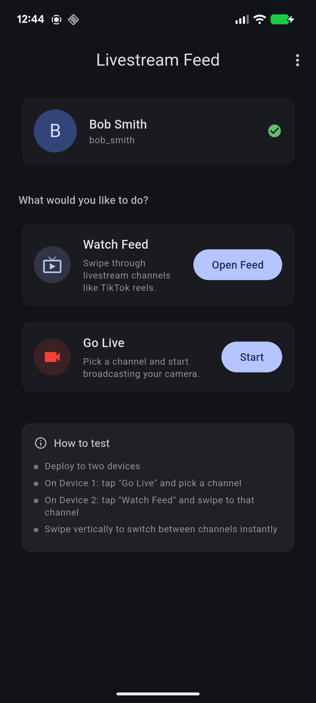
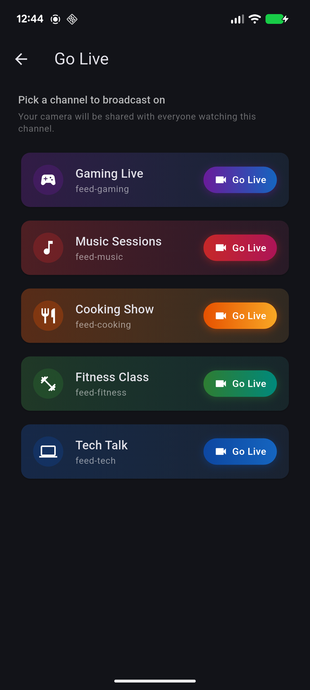

# Livestream Feed Example

A showcase app demonstrating a **TikTok-style vertical livestream feed** using the [Stream Video Flutter SDK](https://pub.dev/packages/stream_video_flutter).

> [!IMPORTANT]
> This sample needs your own Stream API key and user tokens. See [Configuration](#configuration) before running it.

## Screenshots & Demo

| Feed (viewer)           | Host (go live)          |
| ----------------------- | ----------------------- |
|  |  |

**Feed scrolling demo:**


## Use Case

Users browse a vertical feed of livestream channels by swiping up/down. Each swipe leaves the current livestream and joins the next one. A debounced call-switching manager handles rapid swiping gracefully, queuing only the latest channel and skipping intermediate ones.

This pattern is common in:

- **Short-form live video apps** — TikTok Live, Instagram Live, YouTube Shorts Live
- **Live shopping platforms** — browse vendor livestreams
- **Live event apps** — switch between stage cameras or breakout sessions

## How It Works

### Viewer (Feed)

1. **Pick a user** — Two predefined test users (Alice & Bob)
2. **Open the feed** — A full-screen vertical `PageView` of 5 channels
3. **Swipe to switch** — Each swipe triggers the `CallManager` to leave the current livestream and join the next
4. **See live video** — When a host is broadcasting, the viewer sees their camera full-screen with a LIVE badge and viewer count

### Host (Go Live)

1. **Pick a channel** — Select from 5 predefined channels
2. **Go live** — Camera and microphone are enabled, the livestream starts
3. **Broadcast** — Other users in the feed will see the host's video on that channel

### Key SDK Pattern — Call Switching Manager

```dart
class CallManager extends ChangeNotifier {
  Call? _currentCall;
  String? _nextCallId;

  void switchToCall(String callId) {
    _nextCallId = callId;
    if (_state != CallManagerState.connecting) _triggerCallSwitch();
  }

  Future<void> _triggerCallSwitch() async {
    _state = CallManagerState.connecting;
    await _currentCall?.leave();

    final nextCall = StreamVideo.instance.makeCall(
      callType: StreamCallType.liveStream(),
      id: _nextCallId!,
    );
    _currentCall = nextCall;
    _nextCallId = null;

    await nextCall.getOrCreate();
    await nextCall.join(connectOptions: CallConnectOptions(
      camera: TrackOption.disabled(),
      microphone: TrackOption.disabled(),
    ));

    // If another switch was queued during connection, process it immediately
    if (_nextCallId != null) {
      _triggerCallSwitch();
    } else {
      _state = CallManagerState.connected;
      notifyListeners();
    }
  }
}
```

## Running the App

1. Open the project in your IDE
2. Run `flutter pub get`
3. Create `env/env.json` with your Stream credentials, see [Configuration](#configuration)
4. Deploy to **two devices** (physical devices or emulators)
5. **Device 1**: Log in as Alice, tap "Go Live", pick a channel (e.g., "Gaming Live")
6. **Device 2**: Log in as Bob, tap "Watch Feed", swipe to the same channel
7. Bob sees Alice's live video; swipe up/down to switch channels

## Configuration

The sample doesn't contain any Stream credentials. It reads the API key and the user tokens from `env/env.json` when it starts:

| Key | Value |
| --- | --- |
| `STREAM_API_KEY` | Your Stream API key from the [Stream Dashboard](https://dashboard.getstream.io/) |
| `STREAM_TOKEN_ALICE_JOHNSON` | A user token for `alice_johnson` |
| `STREAM_TOKEN_BOB_SMITH` | A user token for `bob_smith` |

The quickest way to create it is the generator script in the repository root. It asks for your API key and secret and signs the tokens locally. The secret is not stored:

```bash
scripts/generate_env.sh packages/video_livestream_feed
```

Alternatively, copy `env/env.example.json` to `env/env.json` and fill in the values yourself. You can generate user tokens with the [token generator](https://getstream.io/chat/docs/flutter-dart/tokens_and_authentication/#manually-generating-tokens).

Then run the sample as usual with `flutter run` or from your IDE. If `env/env.json` is missing values, the app shows a setup screen listing them. `env/env.json` is ignored by git, so your credentials stay out of the repository.

> [!NOTE]
> `env/env.json` is bundled with the app, and tokens created this way don't expire. That's fine for trying the sample out, but in a production app, generate tokens on your server.

## Dependencies

- `stream_video_flutter: ^1.4.0` — Video calling SDK with pre-built UI
- `permission_handler: ^12.0.1` — Runtime camera/microphone permissions
